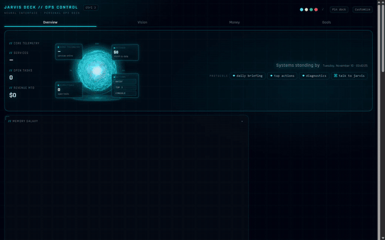

# JARVIS Deck



An open-source, standalone **control deck for your personal agent** — a single
dark dashboard with a plasma neural orb, a memory galaxy of everything your
agent is working on, and a realtime voice loop: hold a button, talk, and
**Jarvis starts answering out loud about one second after you stop talking**.

Built as a local-first companion for a [Hermes Agent](https://github.com/NousResearch/hermes-agent)
style setup, but any backend that serves the same simple JSON routes works.

## What's on the deck

| Surface | What it does |
| --- | --- |
| Neural orb | WebGL plasma core (fbm convection shader) under an always-on neural web that lights up with assistant state (idle / listening / thinking / speaking) — it sits dead-center of the galaxy and the whole thing orbits it |
| Memory galaxy | Star cloud of kanban tasks, cron jobs and monitored services — clustered by status, drag to pan, ctrl+wheel to zoom, click a star for actions (done / break down / delegate / run now / restart / diagnose) |
| Realtime voice | Hold **SPACE** (or the mic button), talk, release — the reply streams back **sentence-by-sentence** with per-sentence streaming TTS, ~1s to first sound. Instant spoken acks ("Right away, sir") fire while the reply is still generating. Barge-in with Esc. TTS providers: edge-tts (free, default), Gemini TTS, Fish Audio voice clones |
| Console | Type or talk to your agent; `/`-commands (`/brief` `/top3` `/diag` `/tasks` `/restart` `/remember` …), rolling conversation memory, dashboard data questions answered from a live snapshot in 1–3s |
| Daily brief / Advisor | Generated operational brief (editable in place), top-3 actions, accountability rows with FIX — the item text becomes the command |
| Goals | Quarterly / monthly / weekly goal sheets + today's task board (add, complete, delegate) |
| Status & Automation | Live service pings with latency LEDs; auto-remediation pings every 5 min and auto-restarts allowlisted services (cooldown + hourly caps) — everything else queues for one-click APPROVE/DENY with Telegram notify |
| Agent activity | Cron runs + board task feed for the last 48h |
| Release board | GitHub releases + CI status for your watched repos |
| Calendar & Inbox | Google Calendar agenda (create + delete events), Gmail inbox — dual-account |
| Telegram & Voice | Your bots' chats with inline reply, Google Voice texts / missed calls / voicemails with reply-by-email |
| Money | Live tickers (Yahoo/Binance, no login), Stripe balance & payouts, Webull positions, sparklines |
| Workshop | Describe an object, the LLM emits structured scene JSON, deterministic 3D renderer builds it — edit parts by prompt |
| HUD companion | Frameless transparent always-on-top Electron overlay (Alt+Space) — mini orb, down services, top tasks |
| Settings | Persona, voice picker (edge / Gemini / Fish), API keys (write-only LEDs), card show/hide, HUD opacity |

## Quickstart

One command gets you a running deck (backend on `127.0.0.1:8785`, web UI on
`http://localhost:4527`):

```bash
git clone https://github.com/DeezGit21/jarvis-deck
cd jarvis-deck
./start.sh        # Windows: double-click start.cmd (or run it in a terminal)
```

The launcher creates a python venv, installs both dependency sets, builds the
frontend and starts both processes. Prefer manual steps?

```bash
npm install                      # frontend deps
npm run build                    # produces dist/

python -m pip install -r requirements.txt   # backend deps (fastapi, uvicorn, pyyaml)

# backend (FastAPI, localhost only)
python -m uvicorn standalone:app --app-dir dashboard --host 127.0.0.1 --port 8785

# frontend (serves dist/)
npx vite preview --port 4527 --strictPort
# or during development:
npx vite --port 4527
```

Open `http://localhost:4527`. The Vite server proxies `/api/plugins/agentos/*`
to `127.0.0.1:8785`; when the backend isn't running the UI falls back to demo data.
No configuration is required for a first run — see below to point the deck at
your own boards, services and agent.

## Configuration

All personal topology lives **outside the repo** in
`~/.hermes/agentos/agentos.yaml` (or the equivalent agent home on your machine).
A fully commented template is in
[config/agentos.yaml.example](config/agentos.yaml.example) — copy it there and
edit. Every key is optional:

```yaml
persona: "you"                      # how the advisor addresses you
hub_url: "http://localhost:3003"    # your business app / CRM
tz_offset_hours: -7

db:                                 # metrics via ssh + psql
  ssh_host: my-db-host
  psql_user: postgres
  psql_db: mydb

services:                           # status-card pings
  - name: My App
    url: http://localhost:3000

release_repos:                      # release board (owner/repo, gh CLI)
  - label: My App
    repo: you/my-app
```

The backend auto-detects the agent data home (`~/.hermes` for CLI setups,
`%LOCALAPPDATA%/hermes` when the desktop app owns it) and reads kanban boards
(`kanban/boards/*/kanban.db`) and cron history (`cron/jobs.json`,
`cron/executions.db`) from there.

## Stack

React 19 + Vite + TypeScript-style JSX · Tailwind 4 · plain 2D-canvas and WebGL
(no heavy 3D deps) · FastAPI backend (stdlib + PyYAML) · react-query-style
polling through a tiny SDK stub (`src/hermes-plugin-sdk.js`), so the frontend
also runs inside the Hermes desktop app as a plugin unmodified.

## Status

Shipped and working:

- [x] Neural orb (state-driven plasma core + neural web, dead-center of the galaxy)
- [x] Memory galaxy (2D canvas, clustered, node action panel)
- [x] Realtime voice: push-to-talk → sentence-streamed replies → streaming TTS (~1s to first sound), edge/Gemini/Fish providers, contextual spoken acks, barge-in
- [x] Console with `/`-commands, rolling session memory, and 1–3s fast-path answers for dashboard data questions
- [x] Auto-remediation: scanner + allowlisted auto-restarts + approval queue + Telegram notify
- [x] Persistent memory card (`remember that…` / `/forget`)
- [x] Goals tab (goal sheets + today board), advisor FIX handoff
- [x] Calendar / Inbox / Telegram / Google Voice cards with inline replies
- [x] Money tab: tickers, Stripe, Webull (browser-session auth), sparklines
- [x] Workshop 3D scene builder
- [x] HUD companion overlay (`npm run hud`)
- [x] Fresh-user launchers (`start.sh` / `start.cmd`), zero-config first boot
- [x] Agent-adapter docs ([docs/ADAPTERS.md](docs/ADAPTERS.md))
- [x] Tagged [v0.1.0](https://github.com/DeezGit21/jarvis-deck/releases/tag/v0.1.0)

## License

MIT — see [LICENSE](LICENSE).
